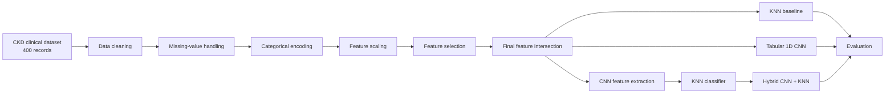

# A Deep Learning Framework for Multi-Modal Prediction of Kidney Disease Progression

Academic major-project repository for **Chronic Kidney Disease (CKD) prediction** using feature selection, classical machine learning, tabular 1D CNNs, and a hybrid CNN + KNN experiment.

> **Academic project, not a medical device.** The models and reported results are for research/educational use and should not be used for clinical diagnosis or treatment decisions.

## Project at a glance

The supplied project report describes a CKD prediction study built around a 400-record clinical dataset. The work covers data cleaning, missing-value handling, categorical encoding, scaling, feature selection, classical ML baselines, 1D CNN classification, and CNN-based feature extraction followed by KNN classification. The report also documents an ensemble line using Logistic Regression, Random Forest, and SVM. The conference paper specifically presents the **hybrid 1D CNN + KNN** approach. See `docs/` for the full thesis and paper.

### What is actually implemented here?

The project title uses the phrase **multi-modal**, but the supplied implementation is primarily based on a **single tabular clinical-data modality**. The repository keeps the original academic title while documenting the implemented pipeline accurately rather than implying additional imaging, signals, or text modalities that are not present in the supplied code/data.

## Repository structure

```text
ckd-kidney-disease-prediction/
├── data/
│   ├── raw/
│   │   └── kidney_disease.csv
│   └── processed/
│       └── final_intersection_dataset.csv
├── notebooks/
│   ├── 01_feature_selection.ipynb
│   ├── 02_knn_classification.ipynb
│   ├── 03_cnn_tabular.ipynb
│   ├── 04_hybrid_cnn_knn_experiments.ipynb
│   ├── 05_cnn_binary_final.ipynb
│   └── 06_prediction_pipeline_final.ipynb
├── results/
│   ├── reported_results.csv
│   └── README.md
├── docs/
│   ├── Final-Thesis.docx
│   └── IEEE-Conference-Paper-Hybrid-CNN-KNN.pdf
├── src/
├── figures/
├── requirements.txt
├── CITATION.cff
├── .gitignore
└── README.md
```

## Research workflow



The supplied paper describes the overall flow as data collection, preprocessing, methodology, and evaluation. It reports use of missing-value imputation, label encoding, normalization, feature selection, train/test splitting, and classification metrics including accuracy, precision, recall, F1-score, Cohen's Kappa and ROC analysis.

## Dataset

The supplied CSV contains **400 rows and 26 columns**: an ID field, clinical/laboratory variables, and the `classification` target. The source materials describe the dataset as a processed CKD clinical dataset derived from the commonly used UCI CKD data and accessed through Kaggle.

The feature-selection notebook selects features through three approaches:

1. **Filter:** ANOVA F-test / `SelectKBest`
2. **Wrapper:** RFE with Logistic Regression
3. **Embedded:** Random Forest feature importance
4. **Intersection:** features common to all three selections

The supplied notebook records the final intersection as:

`hemo, sg, htn, rbc, id, bgr, al`

## Models in this repository

### 1. Feature selection

The supplied implementation compares Filter, Wrapper, Embedded, and Intersection feature subsets using Logistic Regression evaluation.

### 2. KNN baseline

The KNN notebook uses standardized inputs and `KNeighborsClassifier`, with `n_neighbors=5` in the main baseline experiment.

### 3. Tabular 1D CNN

The CNN experiments reshape tabular features into a `(samples, features, 1)` representation and use Conv1D layers followed by pooling, dropout, dense layers, and sigmoid classification.

### 4. Hybrid CNN + KNN

The hybrid experiments use a CNN as a feature extractor and pass the extracted representation to KNN for final classification. The conference paper presents this as the proposed hybrid direction.

### 5. Final binary CNN pipeline

`05_cnn_binary_final.ipynb` is the cleaned submission-oriented notebook supplied with the project. It includes deterministic seeds, robust imputation, class weighting, stratified splitting, model checkpointing, evaluation, and artifact validation.

## Reported results

The supplied notebooks contain several experiment variants. Because the notebooks use different preprocessing choices and train/test splits, these numbers should be read as **reported experiment outputs**, not as one controlled benchmark.

| Experiment | Accuracy | Precision | Recall | F1 |
|---|---:|---:|---:|---:|
| Feature selection - Filter | 99.17% | 100.00% | 97.73% | 98.85% |
| Feature selection - Wrapper | 99.17% | 100.00% | 97.73% | 98.85% |
| Feature selection - Embedded | 98.33% | 97.73% | 97.73% | 97.73% |
| Feature selection - Intersection | 98.33% | 97.73% | 97.73% | 97.73% |
| KNN baseline | 98.33% | 98.68% | 98.68% | 98.68% |
| Final 1D CNN binary notebook | 98.75% | 100.00% | 98.00% | 99.00% |
| Hybrid CNN + KNN experiment | 98.80% | 98.00% | 100.00% | 99.00% |

The project report also describes an ensemble of Random Forest, SVM, and Logistic Regression, while the conference paper focuses on the hybrid CNN-KNN formulation. These are documented separately because they represent different experiment tracks in the supplied materials.

## Reproduce the notebooks

### 1. Clone the repository

```bash
git clone https://github.com/YOUR_USERNAME/ckd-kidney-disease-prediction.git
cd ckd-kidney-disease-prediction
```

### 2. Create an environment

```bash
python -m venv .venv
```

Windows PowerShell:

```powershell
.\.venv\Scripts\Activate.ps1
```

macOS/Linux:

```bash
source .venv/bin/activate
```

### 3. Install dependencies

```bash
pip install -r requirements.txt
```

### 4. Start Jupyter

```bash
jupyter notebook
```

Open the notebooks in this order:

1. `01_feature_selection.ipynb`
2. `02_knn_classification.ipynb`
3. `03_cnn_tabular.ipynb`
4. `04_hybrid_cnn_knn_experiments.ipynb`
5. `05_cnn_binary_final.ipynb`
6. `06_prediction_pipeline_final.ipynb`

The repository copies of the notebooks have been adjusted to use the local `data/` folders instead of the original Google Drive paths where possible.

## Research documents

- **Final thesis:** `docs/Final-Thesis.docx`
- **Conference paper:** `docs/IEEE-Conference-Paper-Hybrid-CNN-KNN.pdf`

The thesis identifies the project as a Bachelor of Technology major project at C. V. Raman Global University and lists Soumya Ranjan Behera, Ayushman Gourav Kar, Riya Kumari, and Ruchika Soren as project members, under the supervision of Dr. Priya Mishra.

## Important reproducibility notes

- The original notebooks were created for Google Colab and contained Google Drive paths. The repository copies replace the main dataset paths with repository-relative paths.
- The supplied project contains multiple experiment variants. Results can differ when notebooks are rerun because of different preprocessing, splits, random seeds, and model configurations.
- Some exploratory hybrid notebook sections are experimental rather than a single finalized training pipeline. Read the notebook comments and the results table before interpreting any metric.
- The repository intentionally keeps the supplied thesis and conference paper as project documentation rather than rewriting their academic claims.

## Limitations

The project uses a small tabular dataset of 400 records. The results are therefore not evidence of clinical effectiveness or generalization to hospital populations. A production-grade medical model would require external validation, careful clinical study design, leakage controls, calibrated probabilities, fairness analysis, and prospective evaluation.

## Authors

- Soumya Ranjan Behera
- Ayushman Gourav Kar
- Riya Kumari
- Ruchika Soren

**Supervisor:** Dr. Priya Mishra, Department of Computer Science & Engineering, C. V. Raman Global University.

## Citation

If you use this repository in academic work, cite the project and the accompanying paper in `docs/`.
